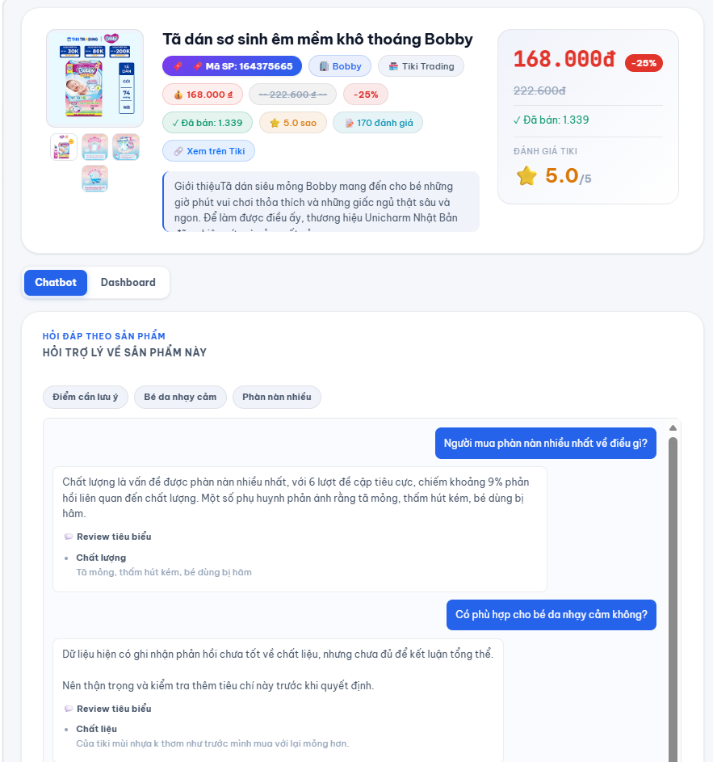
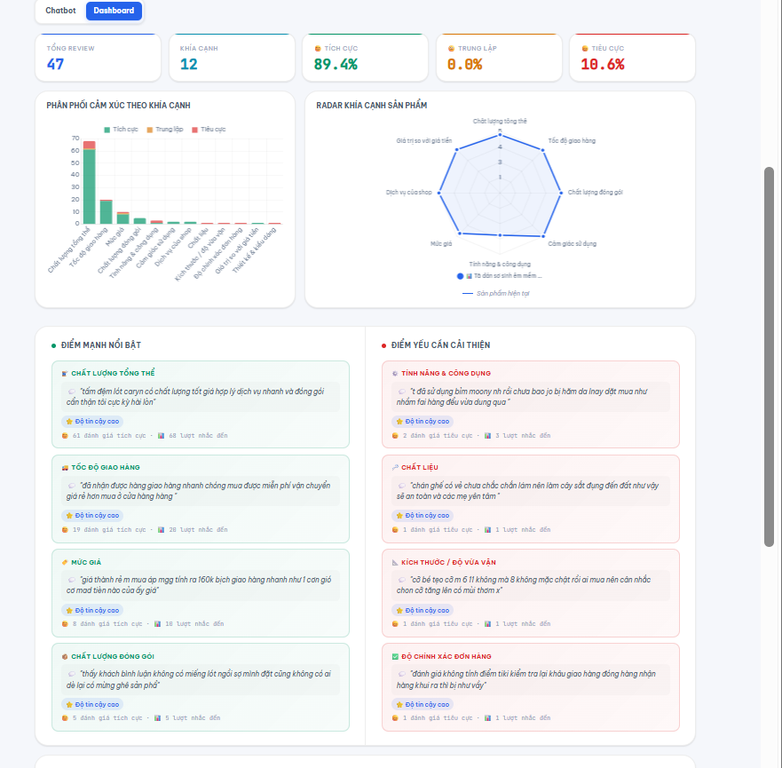
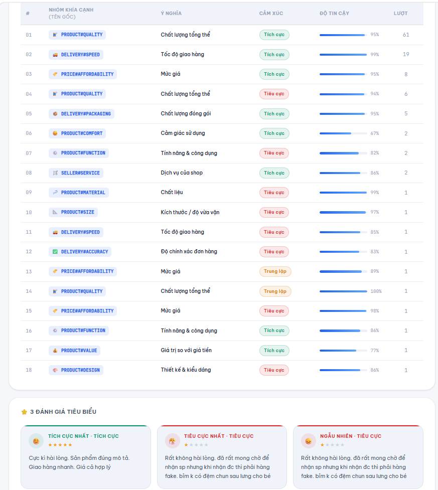

# ReviewInsight - ABSA Dashboard & AI Shopping Assistant

ReviewInsight is an NLP-based system for analyzing customer feedback on baby products from an e-commerce platform. The project combines Aspect-Based Sentiment Analysis (ABSA), product review analytics, and a RAG-powered AI shopping assistant to help users understand product strengths, weaknesses, risks, and purchase suitability from real customer reviews.


## Overview

Online shoppers often need to read many product reviews before deciding whether a baby product is worth buying. Reviews can be long, repetitive, mixed in sentiment, and difficult to summarize manually.

ReviewInsight solves this problem by extracting product aspects from reviews, classifying sentiment for each aspect, summarizing review patterns into a dashboard, and answering product-related questions through an AI shopping assistant.

## Key Features

- Analyze product reviews from a product URL or product ID.
- Extract product aspects and classify sentiment using a fine-tuned PhoBERT ABSA model.
- Visualize product-level sentiment, aspect distribution, strengths, weaknesses, and review evidence.
- Detect risk signals from negative feedback groups.
- Provide an AI chatbot assistant for purchase advice, product fit, and review-based Q&A.
- Combine structured analytics with semantic retrieval through a hybrid RAG pipeline.

## Demo


| Chatbot | Dashboard | Opinion Mining |
|---|---|---|
|  |  |  |

## System Architecture

```text
Product URL / product ID
    |
    v
Crawl product information and reviews
    |
    v
Preprocess reviews and split sentences
    |
    v
PhoBERT ABSA inference
    |
    v
PostgreSQL analytics + risk detection
    |
    v
PostgreSQL + pgvector semantic retrieval
    |
    v
Hybrid RAG ranking and evidence compression
    |
    v
Dashboard + AI Shopping Assistant
```

## Core Technologies

| Area | Technologies |
|---|---|
| Backend | Python, FastAPI, Pydantic, SQLAlchemy |
| Frontend | HTML, CSS, JavaScript, Jinja2, Chart.js |
| NLP / Machine Learning | PhoBERT, PyTorch, Hugging Face Transformers, scikit-learn |
| RAG / LLM | RAG, hybrid retrieval, pgvector, Gemini API, Groq API |
| Database / Cache | PostgreSQL, Redis |
| Data Processing | pandas, NumPy, regex, pyvi, underthesea |
| Infrastructure | Docker, Docker Compose |

## ABSA Models

The project includes several model approaches for research and comparison:

| Model | Role | Notes |
|---|---|---|
| Fine-tuned PhoBERT | Main ABSA model used by the web app | Aspect extraction and aspect-level sentiment classification |
| BiLSTM-CRF | Sequence labeling baseline | Used for model comparison |
| SVM + TF-IDF | Traditional machine learning baseline | Used for comparison with deep learning models |

Recorded experiment results:

| Model | Aspect Detection F1 | Aspect Polarity F1 |
|---|---:|---:|
| PhoBERT | 0.7975 | 0.8519 |
| BiLSTM-CRF | 0.7636 | 0.7951 |
| SVM + TF-IDF | 0.7735 | 0.8361 |

## Analyzed Aspects

The system maps internal aspect labels to user-friendly product insight categories, including:

- Product quality
- Material
- Size
- Safety
- Absorbency
- Comfort
- Durability
- Price
- Delivery
- Packaging
- Authenticity


## Project Structure

```text
project/
|-- app/                  # FastAPI app and runtime services
|   |-- api/              # API route modules and request schemas
|   |-- assistant/        # RAG, LLM, retrieval, scoring, DB services
|   |-- core/             # Shared app utilities and background jobs
|   |-- web/              # Dashboard analysis service
|   |-- static/           # Frontend assets
|   `-- templates/        # Jinja2 templates
|-- data/
|   |-- samples/          # Small sample data for GitHub/demo
|-- docs/
|   |-- images/           # README and demo screenshots
|-- models/
|   |-- README.md         # Model artifact instructions
|-- notebooks/            # Training and experiment notebooks
|-- src/                  # Training model
|-- tests/                # Lightweight regression tests
|-- Dockerfile
|-- docker-compose.yml
|-- pyproject.toml        # Package and pytest configuration
|-- requirements.txt
|-- .env.example
`-- README.md
```

Large datasets, cache files, model checkpoints, and experiment outputs are intentionally excluded from GitHub.

## Setup

### 1. Clone the repository

```powershell
git clone <repository-url>
cd <repository-directory>
```

### 2. Configure environment variables

Create a local `.env` file from the example:

```powershell
copy .env.example .env
```

Update the values in `.env`, especially the LLM provider and API key:

```text
LLM_PROVIDER=gemini
GEMINI_API_KEY=your_gemini_api_key
```

### 3. Add model artifacts

The web app requires the fine-tuned PhoBERT checkpoint:

```text
models/phobert/best_model.pt
```

Model files are not committed to GitHub because they are large artifacts. See `models/README.md` for the expected structure.

## Run With Docker Compose

Requirements:

- Docker Desktop
- `.env` file
- PhoBERT checkpoint at `models/phobert/best_model.pt`

Start all services:

```powershell
docker compose up -d --build
```

Open the app:

```text
http://127.0.0.1:8001
```

Health check:

```text
http://127.0.0.1:8001/api/health
```

Stop services:

```powershell
docker compose down
```

## Run Locally

Create and activate a virtual environment:

```powershell
python -m venv .venv
.\.venv\Scripts\python.exe -m pip install -r requirements.txt
.\.venv\Scripts\python.exe -m pip install -e .
```

The editable install registers the local `app` and `src` packages, so imports work consistently from scripts, tests, Docker, and IDE tools without manual `sys.path` edits.

Start the FastAPI server:

```powershell
.\.venv\Scripts\python.exe -m uvicorn app.main:app --host 127.0.0.1 --port 8001
```

Open:

```text
http://127.0.0.1:8001
```

For local execution, make sure PostgreSQL with pgvector and Redis are available and match the connection values in `.env`.

## Development Checks

Run syntax/import compilation:

```powershell
.\.venv\Scripts\python.exe -m compileall app src -q
```

Run the lightweight test suite:

```powershell
.\.venv\Scripts\python.exe -m pytest
```

The current tests cover health routing, product ID parsing, JSON serialization, purchase scoring, and risk detection without requiring live platform API calls or model inference.


## CV Summary

NLP-based Customer Feedback Analysis and AI Chatbot Assistant for Baby Products. Built a FastAPI web application using PhoBERT, ABSA, PostgreSQL, pgvector, and RAG to analyze product reviews, visualize customer insights, detect risk signals, and answer shopping-related questions from review evidence.
